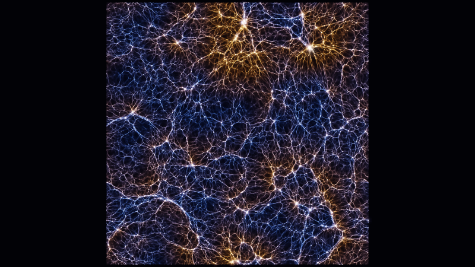

# GPU Cosmology Testbed

A small, fully controlled testbed for dark-matter structure formation, written in Rust and
WGSL (wgpu) and run on a single consumer GPU. It was built to study how numerical choices
(subhalo finder, host matching, completeness, softening, resolution) affect measurements of
warm-dark-matter (WDM) subhalo suppression.



> **Status and caveats.** The science runs in `results/` and the paper in `paper/` are
> **two-dimensional**. No amplitude measured there transfers to the three-dimensional
> Universe, and the mock satellite "limit" is a pipeline-closure exercise, not a dark-matter
> constraint. The code and the paper were written with AI assistance (Claude) and have not
> been peer reviewed. See the paper's Sections 6 and 7 for the known limitations.

## What is here

| Path | What it is |
|---|---|
| `crates/gravity-sandbox` | The simulation: 2D comoving particle-mesh + P³M gravity on the GPU, Zel'dovich initial conditions, CDM and WDM transfer functions, in-run power spectra, snapshots. Also an interactive sandbox (galaxy, subhalo-merger and cosmic-web modes). |
| `crates/sim-core` | CPU physics for the sandbox modes: Barnes-Hut gravity, block timesteps, collisions. |
| `crates/subhalo-finder` | Friends-of-friends, a 2D port of SUBFIND with gravitational unbinding, and merger trees. Binary: `subfind`. |
| `crates/cosmo-analysis` | Power spectra, halo mass functions, WDM suppression fits, host matching, a toy galaxy model, closure test, convergence comparison. |
| `paper/paper.pdf` | "Warm Dark Matter Subhalo Suppression in a 2D GPU Cosmology Testbed". |
| `results/` | Analysis outputs behind the paper (CSV/JSON). Particle snapshots are not included. |
| `docs/` | Offline copies of the two results dashboards and a few images. |

## Build and run

Requires a recent stable Rust toolchain and a GPU with Vulkan, DX12 or Metal support.

```bash
cargo build --release
cargo test --release

# interactive sandbox
cargo run --release -p gravity_sandbox -- --preset normal

# a 2D cosmological run with snapshots (writes to D:\cosmo-runs by default; see --runs-dir)
cargo run --release -p gravity_sandbox -- --preset cosmic

# CDM + WDM experiment, then structure finding and analysis
cargo run --release -p gravity_sandbox -- --experiment
cargo run --release -p subhalo-finder --bin subfind -- --scan <experiments_dir> --host-delta 50
cargo run --release -p cosmo-analysis -- experiment <experiment_dir> --m-complete 160
```

Run any binary with `--help` for its options. The fiducial runs used 6144² particles on a
4096² mesh and take 12–18 minutes per model on an RTX 5080.

## Main results (2D)

- Linear growth reproduced to 0.3%; GPU and offline power spectra agree to 0.05%.
- Resolved subhaloes per Milky-Way-analogue host: 38.5 (CDM) vs 16.1 (WDM, M_hm = 3000 particle masses).
- 2D subhalo suppression reaches 50% at M_peak = 0.40 M_hm, with a ~20% softening systematic.
  This does not agree with 3D fits, in mass or in σ(M).
- An unexplained 10–30% excess of subhaloes at 1–5 M_hm in one WDM model; a second-seed test
  has not been run.

## License

No license has been chosen yet; all rights reserved until one is added.
